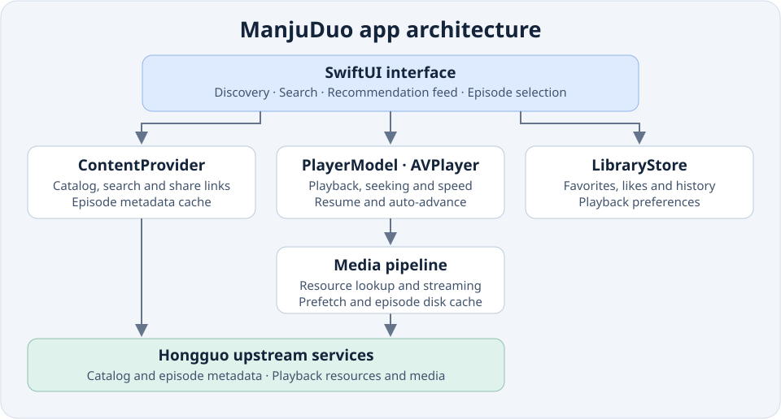

# ManjuDuo

ManjuDuo (漫剧 Duo) is an independent SwiftUI app for browsing and watching Hongguo comic dramas on iPhone and iPad. It supports catalog browsing, a vertical recommendation feed, search, share-link import, episode selection, variable-speed playback, and automatic playback of the next episode.

## System design



The app fetches catalog data and media from upstream services directly on the device. It uses Apple's AVFoundation for playback and requires no separately deployed backend.

| Component | Responsibility |
| --- | --- |
| [Catalog and search](ManjuDuo/Core/ContentProvider.swift) | Reads the Hongguo catalog and episode lists, resolves supported share links, and falls back to a WKWebView-based search when a direct search request fails. Episode metadata is cached in memory and on disk. |
| [Playback source](ManjuDuo/Core/NativePlayback.swift) | Resolves an episode ID to a playable media resource. |
| [Player](ManjuDuo/Playback/PlayerModel.swift) | Drives AVPlayer, restores saved progress, and handles seeking, playback speed, and automatic episode advancement. |
| [Streaming and disk cache](ManjuDuo/Playback) | Reuses cached episodes or prepared streams when available. On a cache miss, the player can open a compatible URL directly or use a custom resource loader to serve media to AVPlayer as it arrives. |
| [Local library](ManjuDuo/Core/LibraryStore.swift) | Stores favorites, likes, and viewing history on the device. Playback preferences use UserDefaults. The optional sign-in session is stored in the [Keychain](ManjuDuo/Core/Account.swift). |

The current episode takes priority. Next-episode prefetch is configurable, and the episode disk cache has a 1 GiB budget. Playback availability and startup time depend on the upstream service, media format, and network connection.

## Adaptive layout

- On narrow screens, the episode list appears below the video when expanded. On wide screens, it appears beside the video.
- In the recommendation feed, playback follows the selected page after scrolling settles on iOS 18 and later. On iOS 17, the app waits for the drag to end and the page selection to stabilize.

## Build and run

The deployment target is iOS 17. Use Xcode 16 or later to build the project.

1. Open `ManjuDuo.xcodeproj` and select the `ManjuDuo` scheme.
2. Choose an iPhone or iPad simulator and run the app.
3. For a physical device, select your Apple development team under **Signing & Capabilities**, then select the device and run.

Run the protocol, parsing, local storage, and media-format checks from the project root.

```sh
zsh scripts/check.sh
```

## License

ManjuDuo is licensed under [GPL-3.0-only](LICENSE). See the [upstream notice](ManjuDuo/Vendor/Upstream-NOTICE.md) for third-party attribution.
